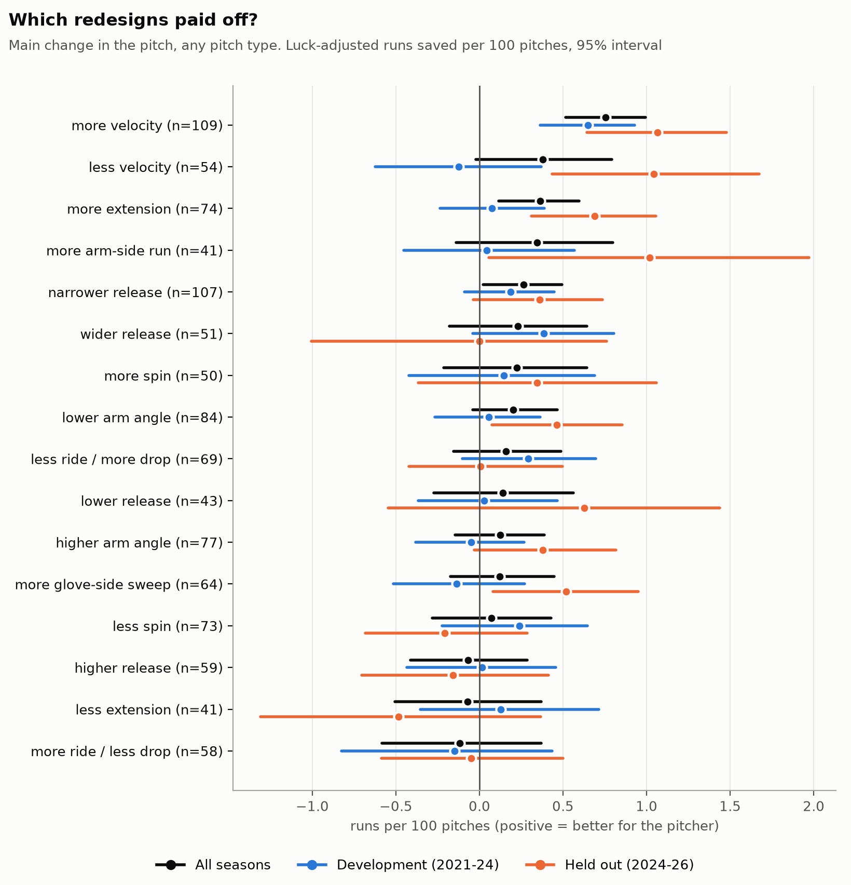
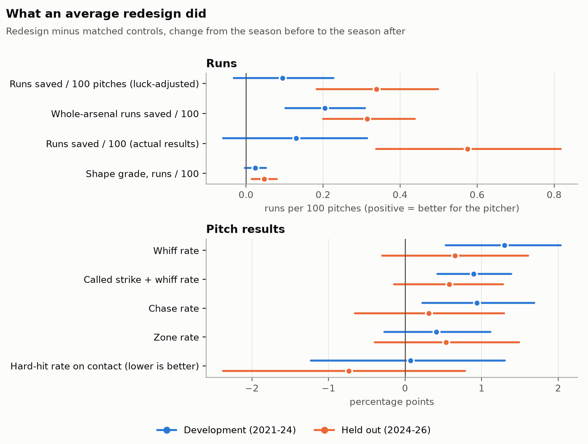
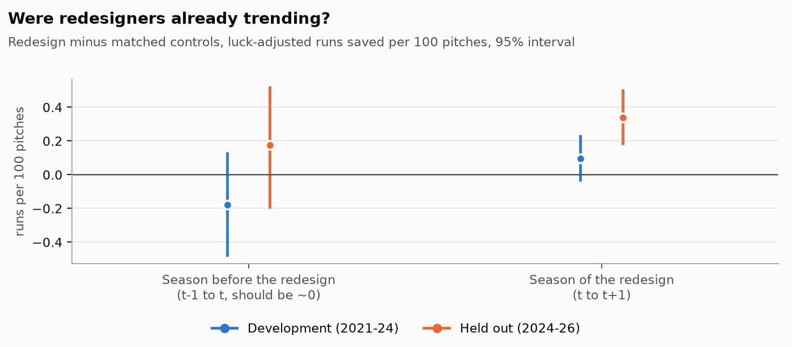
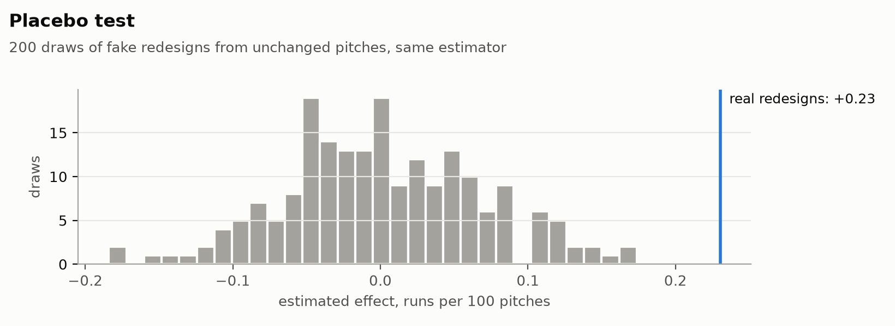
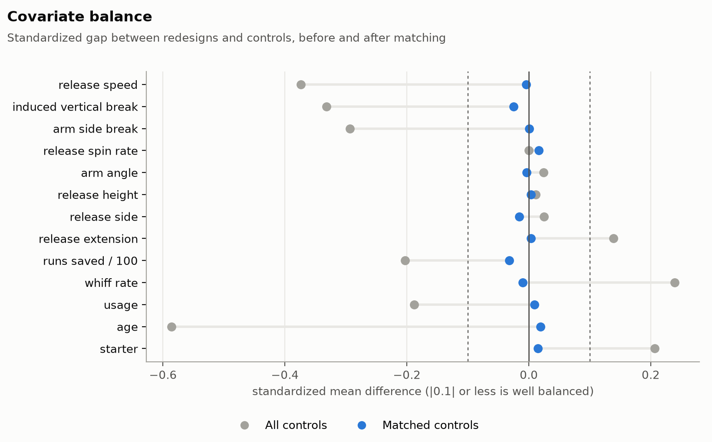

# ShapeShift

**Live site:** https://baseball-chi-rose.vercel.app

**Which offseason pitch redesigns actually work?**

Every winter, pitchers spend weeks in pitch labs adding velocity, chasing ride, or
reshaping a slider. ShapeShift measures what those changes did once the season started.
It uses every public Statcast pitch from 2020 to 2026, and compares each redesigned pitch
with closely matched pitches that did not change.

Most public pitch work grades pitches by their shape (Stuff+). This project asks a
different question, one a player-development group has to answer: **if a pitcher
changes this, what happens to his results?**

## Findings

<!-- results:start -->
- **Sample:** 4,419 pitcher-pitch season pairs from 2021 to 2026: 1,054 redesigns, 1,490 unchanged controls.
- **Average redesign, luck-adjusted runs saved per 100 pitches:** +0.09 (-0.03 to +0.23) in development seasons, +0.34 (+0.18 to +0.50) in the held-out seasons.
- **Whiff rate:** +1.3 (+0.5 to +2.0) pp (development), +0.7 (-0.3 to +1.6) pp (held out).
- **Pre-trend check (season before the redesign):** -0.18 (-0.48 to +0.12) (development), +0.18 (-0.19 to +0.52) (held out).
- **Placebo:** 200 draws of fake redesigns from unchanged pitches, run through the same estimator. 0 of 200 were as extreme as the real estimate (p < 0.005).
- **Change types that survive the false-discovery adjustment and point the same way in both eras:** more velocity (+0.76 (+0.51 to +0.99) runs/100, q=0.016, n=109); more extension (+0.36 (+0.12 to +0.60) runs/100, q=0.032, n=74).
<!-- results:end -->



In plain terms:

- **Velocity is the change that reliably pays.** Of all the types of redesign, a
  velocity gain is the only one with a large effect that holds up in the development
  seasons, the held-out seasons, and after correcting for testing many change types at
  once. It shows up as more swings and misses, not just better luck. It is not
  explained by injured pitchers winning back lost velocity: the effect is the same
  with those cases removed.
- **Extension also clears the bar, more weakly.** It passes the pre-set rule, but most
  of its effect comes from the held-out seasons.
- **"More ride" shows no average effect.** It is the most talked-about pitch-lab change,
  but pitches that gained ride did no better than matched pitches that didn't.
- **An average redesign helps a little, and how much depends on where the line is
  drawn.** The overall estimate is positive and clears the placebo test. It shrinks
  toward zero when the definition of "redesign" is made looser or stricter (see
  [sensitivity](docs/results.md#sensitivity-of-the-main-estimate)). The honest
  headline is the change-type result, not the average.

Full tables, every check, and every figure are in **[docs/results.md](docs/results.md)**.
The design and every rule are in **[docs/research_protocol.md](docs/research_protocol.md)**.

## How it works

1. **Find redesigns without looking at results.** For each pitcher and pitch, compare
   this season's shape with last season's across eight features. These are velocity,
   vertical and horizontal break, spin, arm angle, release height, release side, and
   extension. League-wide drift is removed first. A *redesign* is a change past a
   coaching-sized threshold that is also beyond measurement noise and holds through
   both halves of the new season. A *control* moved on no feature. Outcomes are never
   read at this step, and a test enforces it.
2. **Measure what hitters did, with luck removed.** The main outcome is runs saved per
   100 pitches. Balls in play are valued by their exit velocity and launch angle, not
   by whether they found a hole. Whiffs, chases, called strikes, and contact quality
   are reported alongside.
3. **Compare like with like.** Each redesigned pitch is matched to the 5 most similar
   unchanged pitches from the same pitch group and the same pair of seasons. Similarity
   is judged on pre-season shape, results, usage, age, and role, using a propensity
   score with a 0.2 SD caliper. A regression adjustment cleans up what matching leaves.
4. **Get honest uncertainty.** 95% intervals come from resampling pitchers. On
   simulated leagues with a known answer, the estimator is unbiased and its intervals
   cover the truth 95% of the time.
5. **Try to break it:**
   - a pre-trend check on the season before the redesign;
   - 200 placebo runs with fake redesigns;
   - balance tables;
   - a check that velocity gains aren't injury rebounds;
   - more than a dozen alternative specifications;
   - results for 2021-24 and the held-out 2024-26 shown separately.

| | |
|---|---|
|  |  |
|  |  |

## What this can't tell you

It is an observational study. Matching handles what Statcast measures. It cannot see a
pitcher's health, intent, grip, or a new strength program that changed several things
at once. Pitchers who choose to redesign may also differ in unmeasured ways, such as
access to a pitch lab or a healthy offseason; the pre-trend and placebo checks limit
but cannot rule this out. "Redesign" means a measured change, so velocity *loss* appears as a change
type even though nobody plans it. Pitchers who abandoned a change in spring, or lost
their job, are not in the sample. The [protocol](docs/research_protocol.md#11-what-this-design-cannot-do)
lists these limits in full.

## Reproduce it

Requires Python 3.11 to 3.13 and [uv](https://docs.astral.sh/uv/). About 700 MB of
Statcast downloads. A full run takes roughly 15 minutes on a laptop.

```bash
uv sync
for year in 2020 2021 2022 2023 2024 2025 2026; do
  uv run shapeshift fetch --start $year-03-15 --end $year-10-05
done
uv run shapeshift build-store   # ~4.8M pitches into DuckDB
uv run shapeshift audit         # data-quality table by season
uv run shapeshift study         # grades, classification, matching, checks
uv run shapeshift report        # figures, docs/results.md, this README's numbers
uv run pytest
```

Every number in this README's findings block, in `docs/results.md`, and on the website
is written by `shapeshift report` from `artifacts/reports/study.json`. None is typed by
hand.

## Layout

```
config/default.yaml          every threshold and setting
src/shapeshift/data/         download, schema, features, outcome labels, DuckDB store
src/shapeshift/models/       shape model (no location, count, or identity)
src/shapeshift/study/        aggregate -> classify -> match -> estimate -> report
tests/                       classification, estimator recovery and coverage, features
docs/                        protocol, generated results, figures
web/                         Next.js site that reads web/public/study.json
```

Data: MLB Baseball Savant via [pybaseball](https://github.com/jldbc/pybaseball). This
is an independent project, not affiliated with MLB or any club.
