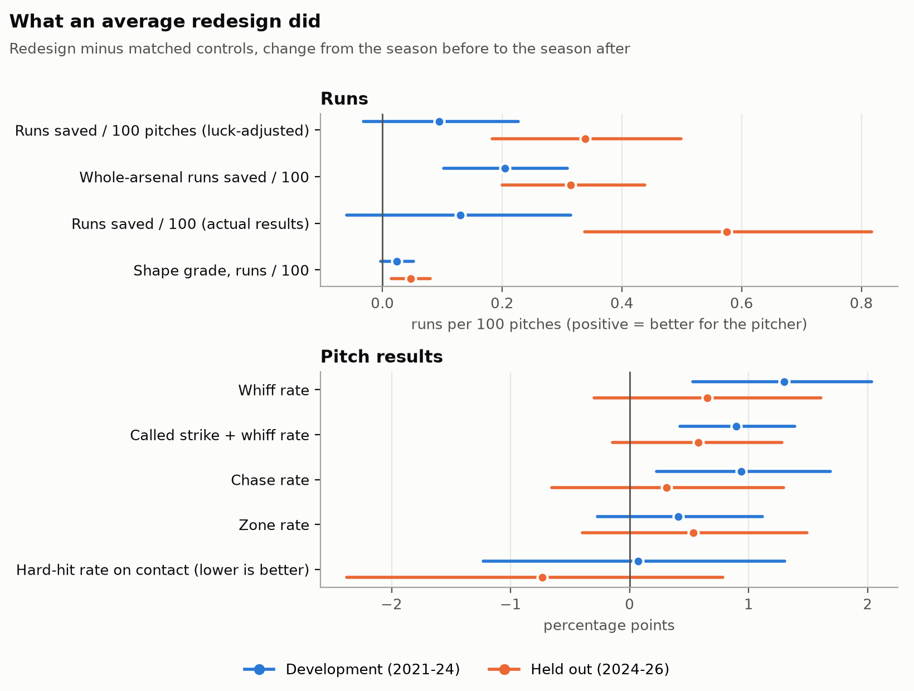
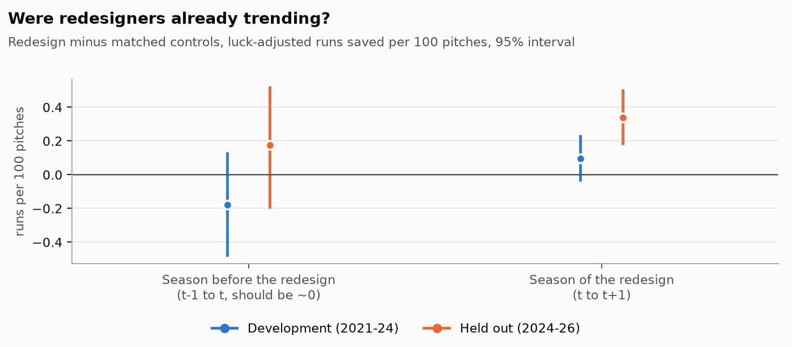
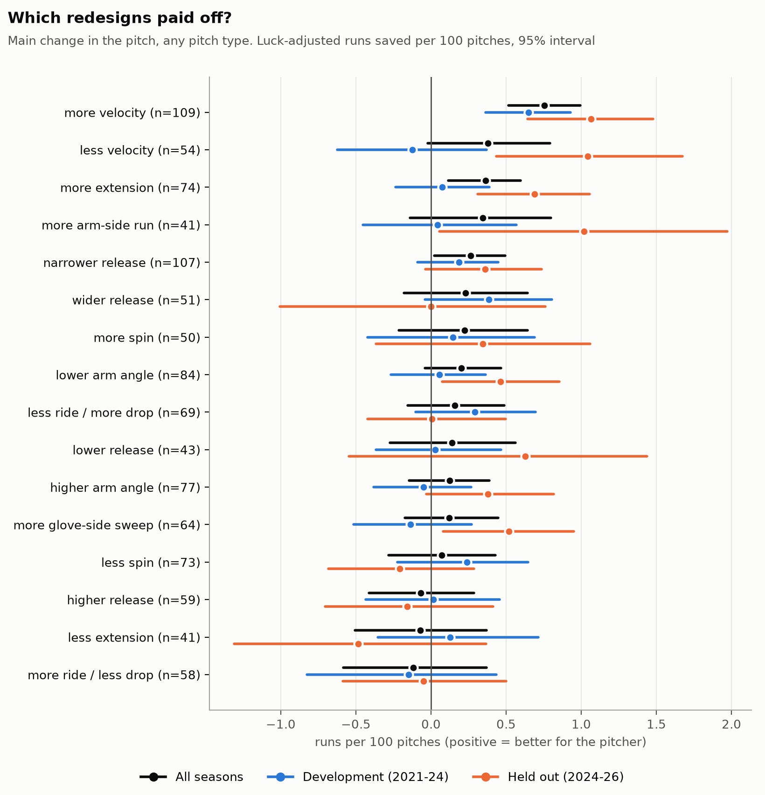
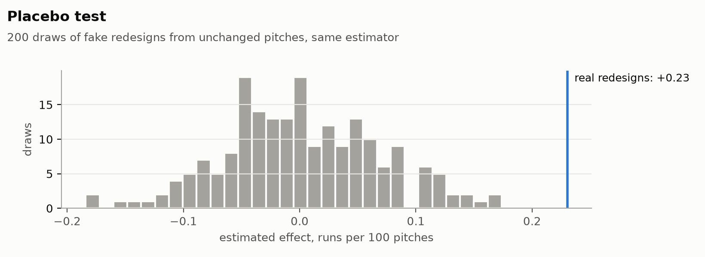
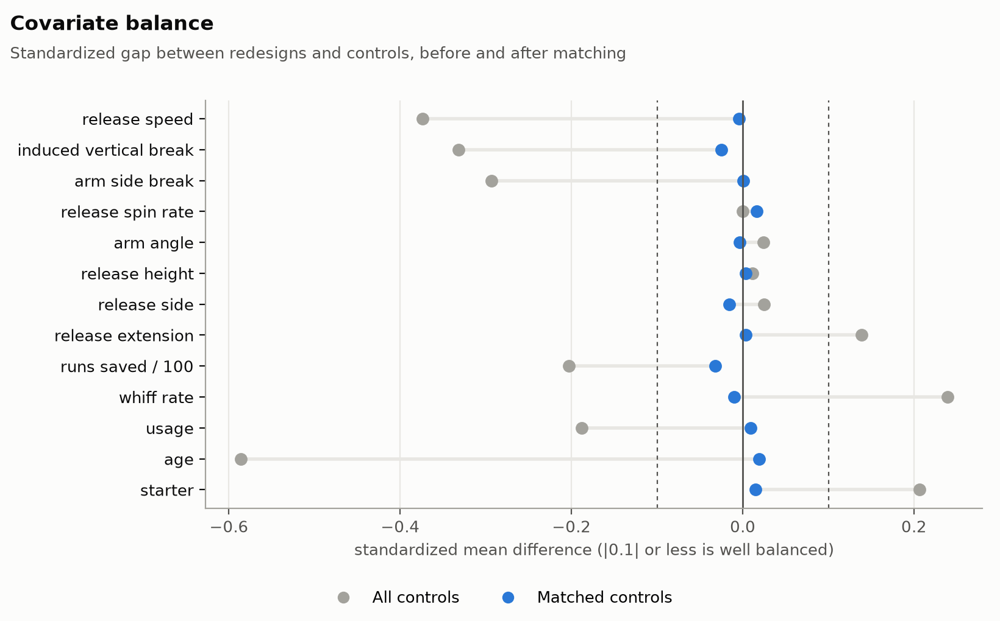

# Results

Generated by `shapeshift report` from `artifacts/reports/study.json` (data fingerprint `ffe7fa09d87f1044`, run 2026-11-14). Do not edit by hand.

All effects are **redesign minus matched controls**, measured as the change from the season before a redesign to the season after. Positive is better for the pitcher. Intervals are 95%, from a pitcher-clustered bootstrap.

## Sample

| Season pair | Redesigns | Controls | Ambiguous (excluded) |
|---|---:|---:|---:|
| 2021-2022 | 222 | 293 | 393 |
| 2022-2023 | 225 | 277 | 406 |
| 2023-2024 | 213 | 322 | 344 |
| 2024-2025 | 198 | 302 | 344 |
| 2025-2026 | 196 | 296 | 388 |

## Main estimates

| Outcome | Development (2021-24) | Held out (2024-26) | All |
|---|---|---|---|
| Runs saved / 100 pitches (luck-adjusted) | +0.09 (-0.03 to +0.23) | +0.34 (+0.18 to +0.50) | +0.23 (+0.13 to +0.33) |
| Whole-arsenal runs saved / 100 | +0.20 (+0.10 to +0.31) | +0.31 (+0.20 to +0.44) | +0.25 (+0.18 to +0.33) |
| Runs saved / 100 (actual results) | +0.13 (-0.06 to +0.31) | +0.57 (+0.34 to +0.82) | +0.37 (+0.21 to +0.51) |
| Shape grade, runs / 100 | +0.02 (-0.00 to +0.05) | +0.05 (+0.02 to +0.08) | +0.04 (+0.02 to +0.06) |
| Whiff rate (pp) | +1.30 (+0.53 to +2.03) | +0.65 (-0.30 to +1.61) | +1.12 (+0.59 to +1.66) |
| Called strike + whiff rate (pp) | +0.90 (+0.42 to +1.39) | +0.57 (-0.14 to +1.28) | +0.83 (+0.43 to +1.20) |
| Chase rate (pp) | +0.94 (+0.23 to +1.69) | +0.31 (-0.65 to +1.29) | +0.49 (-0.11 to +1.08) |
| Zone rate (pp) | +0.41 (-0.27 to +1.12) | +0.54 (-0.40 to +1.49) | +0.40 (-0.08 to +0.88) |
| Hard-hit rate on contact (lower is better) (pp) | +0.07 (-1.23 to +1.30) | -0.73 (-2.38 to +0.78) | -0.41 (-1.37 to +0.47) |
| xwOBA on contact (lower is better) (points) | -1.46 (-10.35 to +6.64) | -9.03 (-20.29 to +1.89) | -7.32 (-13.62 to -0.90) |
| Usage share (pp) | -0.07 (-0.90 to +0.73) | +0.63 (-0.35 to +1.62) | +0.29 (-0.33 to +0.91) |

## Checks

| Check | Development | Held out | All |
|---|---|---|---|
| Pre-trend, runs / 100 (season before the redesign) | -0.18 (-0.48 to +0.12) | +0.18 (-0.19 to +0.52) | -0.09 (-0.33 to +0.14) |
| Redesigns matched within the caliper | 85% | 87% | 88% |

Placebo: 200 draws of fake redesigns from unchanged pitches, run through the same estimator. 0 of 200 were as extreme as the real estimate (p < 0.005).

## Sensitivity of the main estimate

| Specification | Estimate (95% interval) | Redesigns |
|---|---|---:|
| pre-registered | +0.23 (+0.13 to +0.33) | 923 |
| 1 control per redesign | +0.24 (+0.13 to +0.35) | 923 |
| 10 controls per redesign | +0.22 (+0.12 to +0.32) | 923 |
| tighter caliper (0.05 SD) | +0.23 (+0.11 to +0.34) | 642 |
| no regression adjustment | +0.25 (+0.13 to +0.38) | 923 |
| thresholds x0.75 | +0.08 (-0.05 to +0.21) | 1461 |
| thresholds x1.5 | +0.09 (-0.07 to +0.25) | 243 |
| also match on whole-arsenal results | +0.23 (+0.12 to +0.33) | 933 |
| only pitchers with one changed feature | +0.25 (+0.14 to +0.36) | 653 |
| exclude rebounds (feature moved back the year before) | +0.18 (+0.07 to +0.29) | 730 |
| only units with a prior season | +0.23 (+0.12 to +0.34) | 738 |
| protocol v1 thresholds | +0.06 (-0.12 to +0.24) | 1147 |
| drop 2021-2022 | +0.26 (+0.14 to +0.38) | 753 |
| drop 2022-2023 | +0.18 (+0.06 to +0.28) | 726 |
| drop 2023-2024 | +0.24 (+0.12 to +0.36) | 723 |
| drop 2024-2025 | +0.13 (+0.02 to +0.26) | 750 |
| drop 2025-2026 | +0.18 (+0.07 to +0.29) | 762 |

## By type of change, any pitch

Each redesign is labelled by the feature that moved most relative to its threshold. Slices of the one all-seasons matched design. q is the Benjamini-Hochberg false-discovery-adjusted p-value across these rows.

| Change | n | All seasons | q | Development | Held out | Whiff rate (pp) |
|---|---:|---|---:|---|---|---|
| more velocity | 109 | +0.76 (+0.51 to +0.99) | 0.016 | +0.65 (+0.36 to +0.93) | +1.06 (+0.64 to +1.48) | +4.1 (+2.7 to +5.5) |
| less velocity | 54 | +0.38 (-0.02 to +0.79) | 0.256 | -0.12 (-0.62 to +0.37) | +1.04 (+0.44 to +1.67) | +0.2 (-1.6 to +2.0) |
| more extension | 74 | +0.36 (+0.12 to +0.60) | 0.032 | +0.07 (-0.24 to +0.39) | +0.69 (+0.31 to +1.05) | +1.4 (+0.0 to +3.0) |
| more arm-side run | 41 | +0.34 (-0.14 to +0.80) | 0.397 | +0.04 (-0.45 to +0.57) | +1.02 (+0.05 to +1.97) | +0.6 (-1.6 to +2.9) |
| narrower release | 107 | +0.26 (+0.02 to +0.49) | 0.101 | +0.19 (-0.09 to +0.45) | +0.36 (-0.04 to +0.74) | +1.3 (+0.3 to +2.4) |
| wider release | 51 | +0.23 (-0.18 to +0.64) | 0.559 | +0.38 (-0.04 to +0.80) | +0.00 (-1.01 to +0.76) | +0.3 (-1.1 to +1.9) |
| more spin | 50 | +0.22 (-0.21 to +0.64) | 0.559 | +0.14 (-0.42 to +0.69) | +0.35 (-0.37 to +1.06) | +0.9 (-1.4 to +3.1) |
| lower arm angle | 84 | +0.20 (-0.04 to +0.46) | 0.345 | +0.06 (-0.27 to +0.36) | +0.46 (+0.07 to +0.85) | +0.3 (-0.8 to +1.5) |
| less ride / more drop | 69 | +0.16 (-0.16 to +0.49) | 0.559 | +0.29 (-0.10 to +0.70) | +0.01 (-0.42 to +0.50) | +2.4 (+0.4 to +4.8) |
| lower release | 43 | +0.14 (-0.27 to +0.56) | 0.626 | +0.03 (-0.37 to +0.47) | +0.63 (-0.55 to +1.44) | -0.2 (-1.8 to +1.6) |
| higher arm angle | 77 | +0.12 (-0.15 to +0.39) | 0.559 | -0.05 (-0.38 to +0.27) | +0.38 (-0.03 to +0.82) | +1.8 (+0.2 to +3.4) |
| more glove-side sweep | 64 | +0.12 (-0.17 to +0.45) | 0.626 | -0.14 (-0.52 to +0.27) | +0.52 (+0.08 to +0.95) | +0.5 (-1.4 to +2.1) |
| less spin | 73 | +0.07 (-0.28 to +0.43) | 0.758 | +0.24 (-0.22 to +0.65) | -0.21 (-0.68 to +0.29) | -0.3 (-2.1 to +1.5) |
| higher release | 59 | -0.07 (-0.41 to +0.29) | 0.762 | +0.02 (-0.44 to +0.46) | -0.16 (-0.71 to +0.41) | -0.0 (-1.9 to +1.7) |
| less extension | 41 | -0.07 (-0.51 to +0.37) | 0.763 | +0.13 (-0.35 to +0.71) | -0.49 (-1.31 to +0.37) | +1.5 (-0.4 to +3.3) |
| more ride / less drop | 58 | -0.12 (-0.58 to +0.37) | 0.757 | -0.15 (-0.83 to +0.43) | -0.05 (-0.59 to +0.50) | -0.0 (-3.0 to +2.8) |

### Is the velocity result just injury recovery?

14 of 109 velocity gains won back at least 1 mph lost the season before. Effect on runs saved per 100 pitches: +0.76 (+0.51 to +0.99) for all gains, +0.76 (+0.49 to +1.02) excluding rebounds.

## By pitch and type of change

Pitch group x change type cells with at least 25 redesigns. Runs saved per 100 pitches of that pitch.

| Pitch | Change | n | All seasons | Development | Held out |
|---|---|---:|---|---|---|
| Slider/sweeper | more velocity | 30 | +0.85 (+0.42 to +1.28) | +0.71 (+0.21 to +1.21) | +1.25 (+0.46 to +2.23) |
| Four-seam | more extension | 26 | +0.37 (-0.04 to +0.81) | +0.22 (-0.29 to +0.70) | +0.54 (-0.10 to +1.24) |
| Four-seam | narrower release | 41 | +0.23 (-0.07 to +0.55) | +0.01 (-0.37 to +0.38) | +0.58 (+0.07 to +1.12) |
| Slider/sweeper | more glove-side sweep | 37 | +0.17 (-0.24 to +0.58) | +0.07 (-0.38 to +0.54) | +0.48 (-0.42 to +1.40) |
| Four-seam | lower arm angle | 38 | +0.00 (-0.34 to +0.37) | -0.37 (-0.79 to +0.10) | +0.49 (-0.11 to +1.06) |
| Changeup | less spin | 25 | -0.00 (-0.68 to +0.63) | +0.41 (-1.12 to +1.64) | -0.17 (-0.96 to +0.62) |
| Slider/sweeper | less ride / more drop | 27 | -0.10 (-0.51 to +0.32) | -0.20 (-0.75 to +0.37) | -0.00 (-0.61 to +0.63) |

## Shape model

Year-to-year correlation for the same pitcher and pitch (pitch-seasons with 150+ pitches). A shape grade is useful if it is stable and predicts next season's results better than this season's results do.

| Pitch | Pairs | Grade r(t, t+1) | Results r(t, t+1) | Grade -> next results | Results -> next results |
|---|---:|---:|---:|---:|---:|
| Changeup | 570 | 0.69 | 0.33 | 0.27 | 0.33 |
| Curveball | 501 | 0.78 | 0.27 | 0.20 | 0.27 |
| Cutter | 392 | 0.74 | 0.18 | 0.27 | 0.18 |
| Four-seam | 1580 | 0.78 | 0.31 | 0.27 | 0.31 |
| Sinker | 818 | 0.80 | 0.28 | 0.32 | 0.28 |
| Slider/sweeper | 1170 | 0.70 | 0.25 | 0.19 | 0.25 |
| Splitter | 134 | 0.61 | 0.35 | 0.31 | 0.35 |

## Figures

